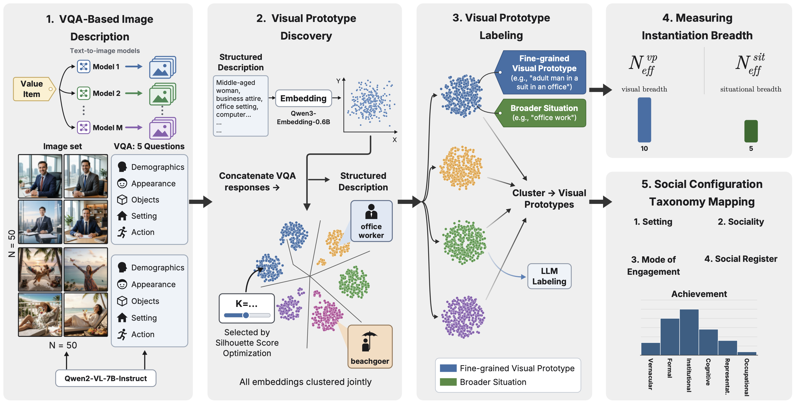

# Instantiation of Human Values in Image Generation



Text-to-Image (T2I) models are increasingly embedded in everyday visual culture, yet little is known about how they translate abstract human values into visual scenes. We introduce a framework, grounded in Schwartz's theory of basic human values, for studying *value instantiation*: the process by which ideals such as *success*, *care*, or *freedom* are visually realized. Using person-centered prompts for positive and negative value items, we generate 28,000 images across four state-of-the-art T2I models. We identify **visual prototypes** (recurring combinations of subjects, appearances, actions and settings), use them to quantify how narrowly models instantiate values, and map them onto a taxonomy of **social configurations** spanning setting, sociality, mode of engagement and social register. Finally, we show that the structural gaps can be turned into **steering signals** that broaden outputs without modifying the original prompt.

## Setup

```bash
pip install -r requirements.txt
```

Experiments were run on an NVIDIA A100 GPU. The labeling and auxiliary-scene steps call Qwen2.5-72B-Instruct through an OpenAI-compatible server:

```bash
vllm serve Qwen/Qwen2.5-72B-Instruct --tensor-parallel-size 4
```

## Files

| File | Step |
|---|---|
| `prompts.csv` | positive / negative prompt per value item, with its Schwartz domain |
| `taxonomy_definitions.json` | social-configuration categories and their descriptions |
| `generate_images.py` | images with FLUX.2 Klein 9B, Qwen-Image, SD3.5 Medium |
| `generate_images_gemini.py` | images with Gemini 2.5 Flash Image (Replicate) |
| `extract_vqa_descriptions.py` | five-question VQA description of every image (Qwen2-VL-7B) |
| `cluster_prototypes.py` | joint K-means clustering into visual prototypes |
| `label_prototypes.py` | LLM visual-prototype and situation labels |
| `compute_breadth.py` | visual and situational breadth (inverse Simpson index) |
| `map_taxonomy.py` | prototypes → social-configuration categories |
| `generate_auxiliary_scenes.py` | LLM scenes for under-represented configurations |
| `steer.py` | embedding-space steering and prompt-augmentation baseline |
| `utils.py` | shared helpers |

## Pipeline

`bash run_pipeline.sh` runs all steps.

**1. Image generation.** 50 images per prompt and model, one seed per image:
```bash
python generate_images.py --model flux2 --out data/images/flux2      # also: qwen, sd35
python generate_images_gemini.py --out data/images/gemini            # needs REPLICATE_API_TOKEN
```
Images are saved as `data/images/<model>/<domain>/<value>/<positive_prompt|negative_prompt>/`.

**2. VQA descriptions.** Each image is described by five fields: demographics, appearance, objects, setting and action.
```bash
python extract_vqa_descriptions.py --img_root data/images/flux2 --model_name flux2 --output data/vqa/flux2.json
```

**3. Visual prototypes.** The five fields are joined into one text and embedded with Qwen3-Embedding-0.6B. All models and values are then clustered *jointly* with K-means, with K chosen by silhouette score. An LLM gives each cluster a fine-grained label (e.g. *adult man in a suit sitting at a desk in an office*) and a situation label (e.g. *office work*).
```bash
python cluster_prototypes.py --inputs data/vqa/*.json --outdir results/clustering
python label_prototypes.py --clusters results/clustering/cluster_tags.json --output results/clustering/prototype_labels.csv
```

**4. Breadth and taxonomy.** Breadth is the inverse Simpson index N_eff = 1 / Σ π², computed over prototypes (visual breadth) and over situations (situational breadth) for each model × value. Each prototype is then mapped to a category on each of the four taxonomy axes, by cosine similarity with a majority vote across three text encoders.
```bash
python compute_breadth.py --assignments results/clustering/assignments.csv \
    --labels results/clustering/prototype_labels.csv --output results/breadth.csv
python map_taxonomy.py --labels results/clustering/prototype_labels.csv \
    --assignments results/clustering/assignments.csv --outdir results/taxonomy
```

**5. Steering.** For the most concentrated values, an LLM writes auxiliary scenes for missing configurations. Each scene is then injected into the post-[EOS] padding positions of the prompt embedding, ĉ = c_base + λ M ⊙ (c_aux − c_∅), for the first τ of denoising steps. The prompt's own tokens are left unchanged. `--method prompt_aug` instead appends the scene to the prompt as a baseline.
```bash
python generate_auxiliary_scenes.py --breadth results/breadth.csv --assignments results/clustering/assignments.csv \
    --labels results/clustering/prototype_labels.csv --output results/aux_scenes.json
python steer.py --model flux2 --method embed --aux results/aux_scenes.json \
    --orig_root data/images/flux2 --out data/steered/flux2/embed
```

Steering a single prompt:
```bash
python steer.py --model flux2 --prompt "a successful person" \
    --scenes "a group of people of different ages celebrating at home" "a person in workwear at a construction site" \
    --out results/steered/demo
```

| Model | λ | τ | guidance |
|---|---|---|---|
| FLUX.2 | 1.5 | 0.6 | 4.0 |
| SD3.5 | 1.0 | 0.4 | 7.0 |
| Qwen-Image | 1.5 | 0.4 | 6.0 |
